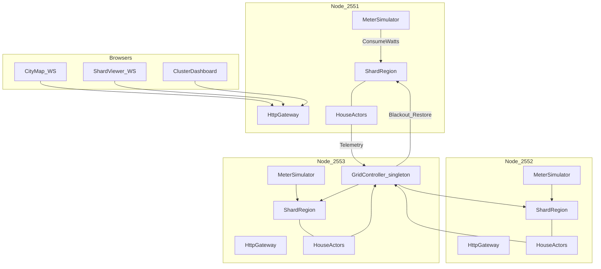
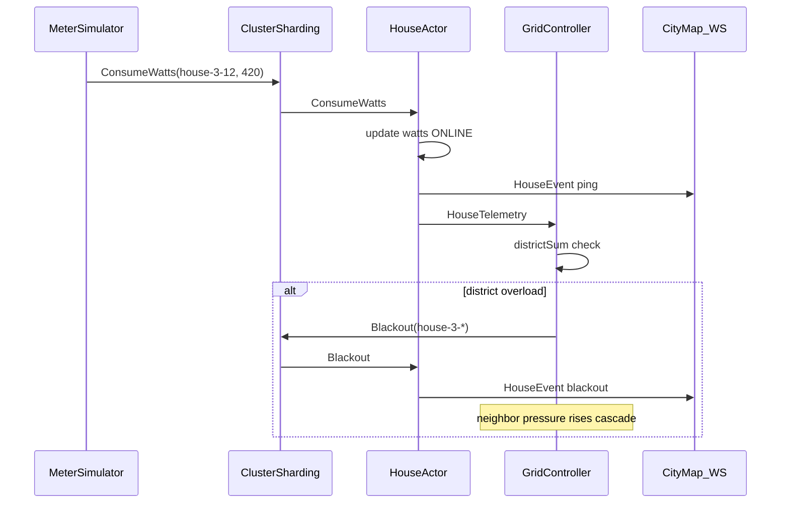

# Architecture — Town Power Cluster Simulator

Living design for `akka-distribute-manager`: a **Java 21** demo cluster that models a small town’s electricity use with actors, live UI, and cascade blackouts.

Inspired by [mckeeh3/akka-typed-java-cluster-sharding](https://github.com/mckeeh3/akka-typed-java-cluster-sharding) (HTTP + WebSocket + d3 dashboard / shard viewer), rebuilt on **Apache Pekko** with a domain story.

---

## 1. Goals

| Goal | Detail |
|------|--------|
| Teach cluster sharding | Many house entities, location-transparent IDs, passivation, rebalance |
| Feel like a product | Town map UI that reacts in realtime to meter ticks and blackouts |
| Runnable locally | 3 JVMs on loopback, one script to start/stop |
| Java 21 native | No Java 11 leftovers |

### Non-goals (v1)

- No persistence / event sourcing / CQRS
- No Kubernetes / multi-host networking
- No auth, multi-tenant, or production SLAs
- No React SPA build pipeline (static HTML/CSS/JS like the reference)
- No real utility protocols (IEC 61850, etc.)

---

## 2. Locked decisions

| ID | Choice | Why |
|----|--------|-----|
| Stack | **Apache Pekko 1.1.x** + Pekko HTTP + Jackson CBOR | Apache-2.0, official JDK 21, same typed APIs as Akka sample |
| State | **In-memory only (1A)** | Fast demo; kill node → entities cold-start empty |
| Stress reaction | **Cascade blackout (2A)** | Overload trips a district; neighbors cascade; map goes dark |
| Scale (default) | ~300 houses, 6 districts, 18 shards, 3 nodes | Enough to see rebalance without drowning the UI |
| License note | Prefer Pekko over commercial Akka 2.7+ for this toy | Avoid Lightbend BCL friction |

Fallback: if Pekko HTTP packaging fights us, keep Pekko actors and serve static UI via a tiny JDK `HttpServer` — domain actors stay Pekko either way.

---

## 3. Domain story

Imagine a **shahrak** (small town):

- Houses and buildings sit on a grid.
- Each building has a **smart meter** that emits watt samples over time (day/night curve + noise).
- A **district** sums load for its houses.
- A **grid controller** (cluster singleton) watches district totals against capacity.
- When a district exceeds capacity → **trip** that district (blackout).
- Blackout raises relative load on neighbors → **cascade** until load sheds or whole town dark.

Actors react online: meter tick → house state update → telemetry → aggregate → maybe `Blackout` / `Restore` commands back into houses → UI paints heat / darkness.

---

## 4. Runtime topology



**Ports (local demo)**

| Role | Node A | Node B | Node C |
|------|--------|--------|--------|
| Remoting | 2551 | 2552 | 2553 |
| HTTP UI | 9551 | 9552 | 9553 |
| Management (optional) | 8551 | 8552 | 8553 |

Seed nodes: `2551`, `2552`. Runner script mirrors the reference `scripts/local-cluster.py` idea.

---

## 5. Actor model

### 5.1 `HouseActor` (Cluster Sharding entity)

- **Entity id:** `house-{districtId}-{houseNo}` (stable logical id).
- **State (memory):** `watts`, `status` ∈ `{ONLINE, BLACKOUT}`, `districtId`, `coords` (row,col for map), rolling short window for UI sparkline optional.
- **Commands:**
  - `ConsumeWatts(watts, at)` — meter sample
  - `Blackout(reason)` — force dark; ignore/zero consumption until restore
  - `Restore` — back online
  - `GetStatus(replyTo)` — query
  - `Passivate` — idle stop (sharding)
- **Effects:** on every meaningful change, publish `HouseEvent` to local `UiHub` / `HttpServerActor` (same pattern as reference `notifyHttpServer`).

Passivate after idle (e.g. 30s) so sharding stays honest under sparse traffic.

### 5.2 `MeterSimulator` (per node, local)

- Timer tick (~100–200 ms).
- Picks random (or round-robin) house IDs **owned conceptually by this demo** (or any id — sharding routes).
- Applies day/night sine + noise; if house is blacked out, simulator can still send ticks (house clamps to 0) so restore is visible when grid heals.
- Replaces reference `EntityCommandActor` / `EntityQueryActor`.

### 5.3 `DistrictView` (local aggregator OR sharded)

v1 keep it simple: **GridController** holds `Map<districtId, DistrictLoad>` updated from house telemetry. No separate district entity unless profiling says hot.

### 5.4 `GridController` (Cluster Singleton)

- Subscribes to / receives `HouseTelemetry(houseId, districtId, watts, status)`.
- Maintains per-district sum and capacity (`capacityWatts` config).
- **Trip rule:** if `sum > capacity` for `stableFor` (e.g. 1s) → emit `Blackout` to all houses in that district.
- **Cascade:** blackout zeros that district’s load but neighbors keep rising; if neighbor also exceeds → trip next. Optional `contagionFactor` when adjacent district trips (bump effective load % to speed demo).
- **Restore rule:** after `cooldown`, if global headroom exists, restore darkest district first (or random) so UI shows recovery waves.

### 5.5 `HttpServerActor` + static gateway

Same role as reference:

- Serve `city.html`, `viewer.html`, `dashboard.html`, JS/CSS.
- WebSocket fan-out of tree / heatmap snapshots.
- Broadcast entity actions across nodes via receptionist or cluster pub-sub (reference uses `HttpServerActor` + broadcast).

### 5.6 `ClusterListenerActor`

Membership events → dashboard JSON (Up / Leaving / Unreachable).

---

## 6. Message & data flow



Serialization: Jackson CBOR binding on a marker interface (`CborSerializable`), Pekko config under `pekko.actor.serialization-bindings`.

---

## 7. Cascade blackout algorithm (v1)

Config knobs (`application.conf`):

```hocon
town {
  districts = 6
  houses-per-district = 50
  district-capacity-watts = 8000
  overload-stable-for = 1s
  blackout-cooldown = 5s
  cascade-bump-ratio = 0.15   # when neighbor trips, treat adjacent load as +15%
  meter-tick = 150ms
}
```

Pseudocode:

1. On telemetry: update house watts; recompute `districtSum[d]`.
2. If `districtSum[d] > capacity` longer than `overload-stable-for` and district not already BLACKOUT → **trip(d)**.
3. `trip(d)`: mark district BLACKOUT; send `Blackout` to each house id in d; set `districtSum[d]=0`.
4. Apply `cascade-bump-ratio` to adjacent districts’ *effective* load for the next evaluation window (demo accelerator).
5. After `blackout-cooldown`, if `globalSum < 0.7 * globalCapacity`, **restore** one blacked district (FIFO or random).
6. Repeat; UI shows waves of darkness and recovery.

No persistence: singleton failover restarts empty → map rebuilds as meters tick again (acceptable for 1A).

---

## 8. UI design

Two surfaces (plus optional thin cluster dashboard):

### 8.1 City map (`/city`) — primary wow

- Full-bleed grid of buildings (CSS/canvas or d3).
- Color = load intensity (cool → hot); BLACKOUT = near-black with sparse flicker.
- District borders subtle; click house → side panel (id, watts, node, shard).
- Live via WebSocket ` /ws/city` pushing diffs `{houseId, watts, status, member}`.
- Top bar: cluster member count, total MW, blackout district count, msgs/s.

### 8.2 Shard viewer (`/viewer`) — teaching view

Port the reference idea: radial/tree cluster → member → shard → entity, WebSocket updates on start/ping/stop/passivate. Relabel entities as houses.

### 8.3 Cluster dashboard (`/dashboard`)

Lightweight membership + per-node activity (like reference). Not the hero; city map is.

**Visual direction:** night-town energy map (deep slate background, amber overload, cyan online). Avoid generic purple AI-slop palette. Static assets under `src/main/resources/ui/`.

---

## 9. Package layout (proposed)

```text
ir.sharifi.townpower/
  Main.java
  CborSerializable.java
  house/
    HouseActor.java
    HouseProtocol.java
  sim/
    MeterSimulator.java
  grid/
    GridController.java
    GridProtocol.java
  cluster/
    ClusterListenerActor.java
  http/
    HttpServer.java
    HttpServerActor.java
    UiModels.java
src/main/resources/
  application.conf
  logback.xml
  ui/city.html | city.js | city.css
  ui/viewer.html | viewer.js
  ui/dashboard.html | ...
scripts/local-cluster.py
docs/ARCHITECTURE.md          ← this file
```

Maven: `pekko-bom_2.13` 1.1.x, modules `pekko-actor-typed`, `pekko-cluster-typed`, `pekko-cluster-sharding-typed`, `pekko-serialization-jackson`, `pekko-http`, `pekko-stream`, management optional.

---

## 10. Acceptance criteria (v1 done when)

1. `scripts/local-cluster.py start` brings up 3 nodes; seed forms cluster.
2. Open `http://localhost:9551/city` → houses light up within seconds as meters tick.
3. Force overload (config or UI “stress” button) → at least one district blacks out; cascade reaches a neighbor within ~10s.
4. After cooldown + load drop, a district restores; houses glow again.
5. `/viewer` shows houses under shards/members; kill one JVM → entities reappear on remaining nodes (cold state OK).
6. Java 21 build: `mvn -q package` green.

---

## 11. Implementation slices (build order)

Lean order — stop when acceptance passes:

| Slice | Deliverable |
|-------|-------------|
| S0 | Pekko POM, `application.conf`, empty `Main` boots 1 node |
| S1 | `HouseActor` + sharding + unit-ish self-check |
| S2 | `MeterSimulator` ticks → logs |
| S3 | HTTP static + WS stub |
| S4 | City map paints telemetry |
| S5 | `GridController` singleton + blackout cascade |
| S6 | Shard viewer + 3-node script |
| S7 | Stress button + polish copy |

Out of scope until asked: persistence, Kubernetes, auth, metrics backends.

---

## 12. Risks

| Risk | Mitigation |
|------|------------|
| WS fan-out floods browser | Diffs + throttle (~10 Hz) + pause when tab hidden |
| Singleton loses state on failover | Expected under 1A; UI recovers via ticks |
| Too many DOM nodes | Canvas/WebGL grid if >500 houses |
| Pekko HTTP version skew | Pin via BOM; drop to JDK HTTP for static if needed |

---

## 13. Reference mapping

| Reference (Akka sample) | This project |
|-------------------------|--------------|
| `EntityActor` | `HouseActor` |
| `EntityCommandActor` | `MeterSimulator` |
| `ClusterSingletonActor` | `GridController` |
| `HttpServer` / WS tree | City map + viewer |
| Random id/value | Watts + blackout status |
| Passivate idle | Keep |

---

---

## 14. Demo walkthrough (operator)

1. **City map** — open `/city`; scenario buttons (ظهر / شب / موج گرما / آرام) via `POST /api/scenario/{id}`.
2. **District drill** — click منطقه → محله list; optional `قطع ۵ پرمصرف`.
3. **Node fail** — open `/viewer`, run `./scripts/node-fail-demo.sh node3`; Up 3→2; entities flash **MOVED** on member change.
4. **Cluster JSON** — `GET /api/cluster` for member addresses / Up count.

*Last updated: 2026-11-02 — LoadModel + supervisor DSM + district drill + node-fail demo.*
